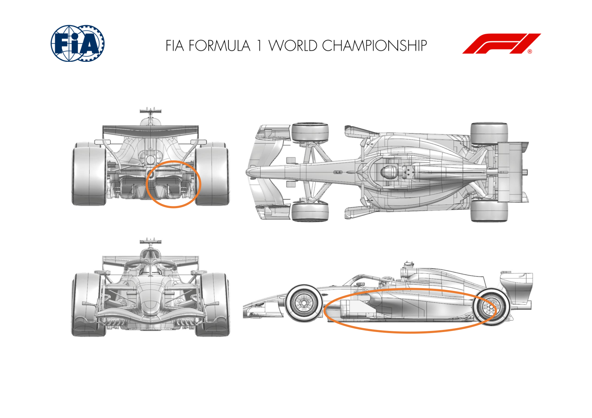
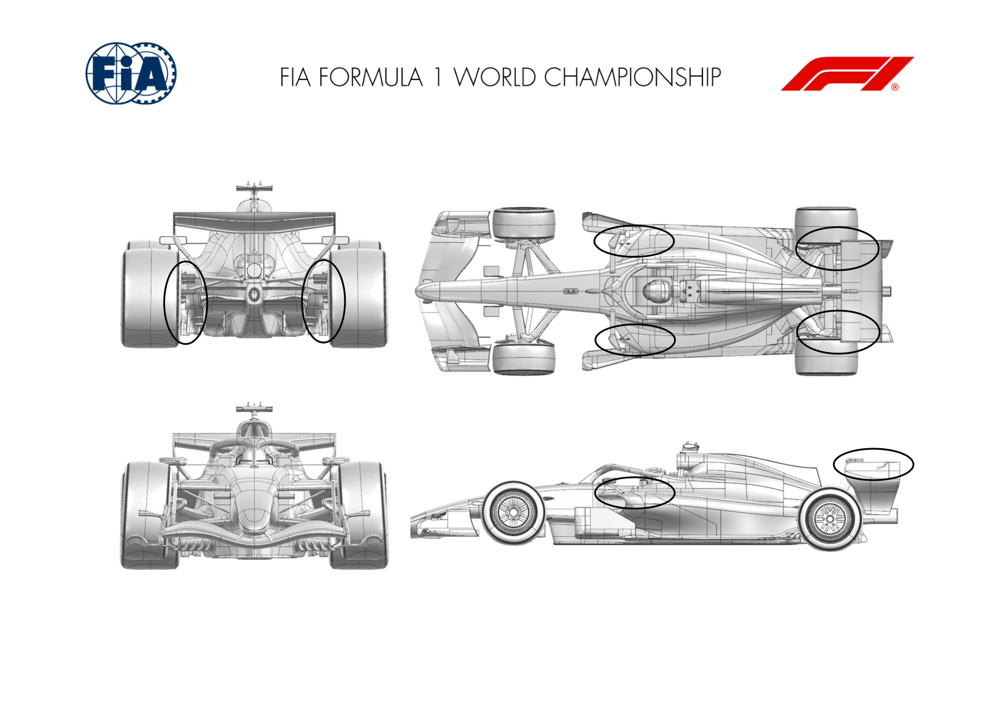
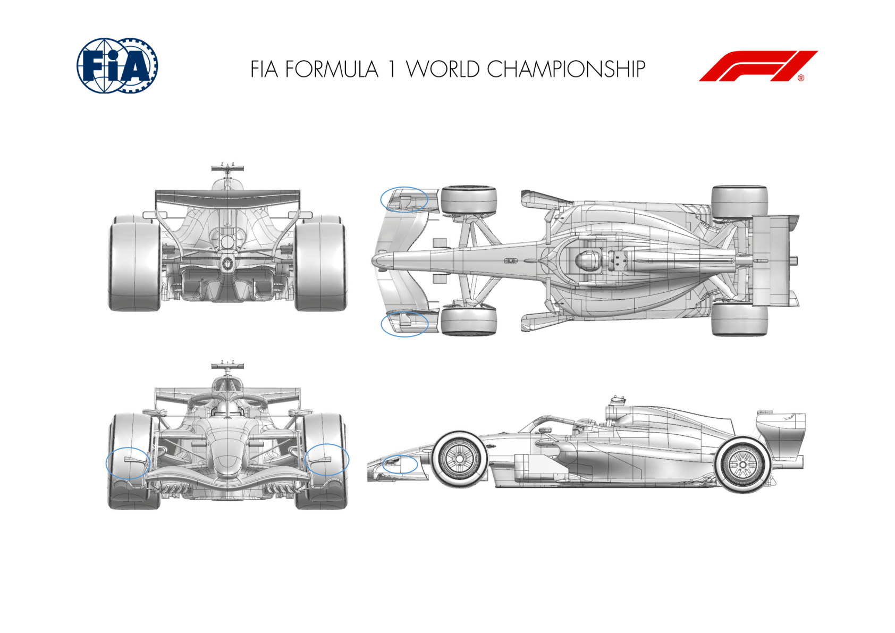
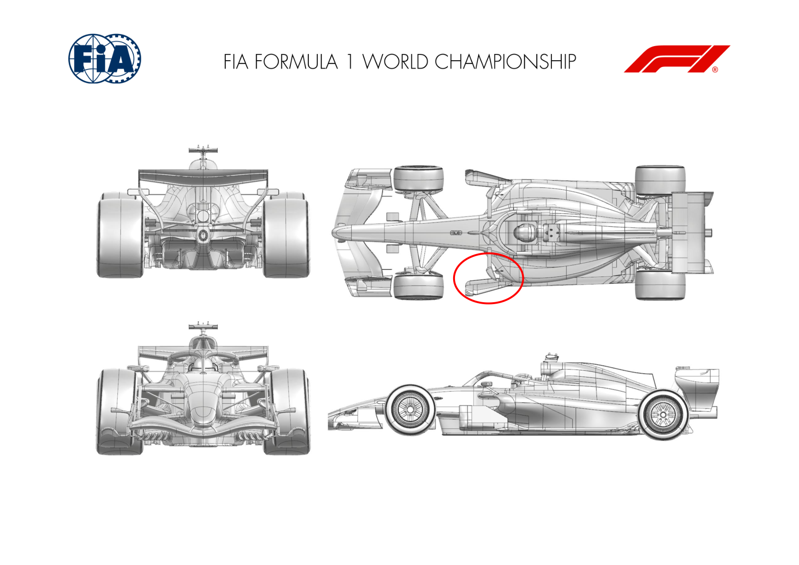
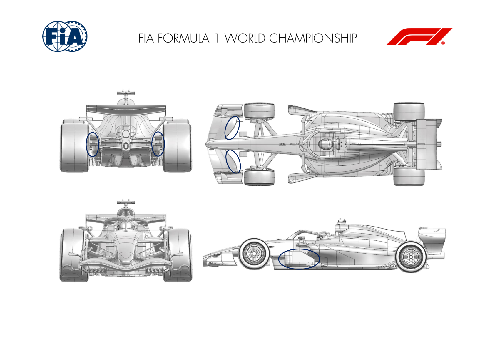
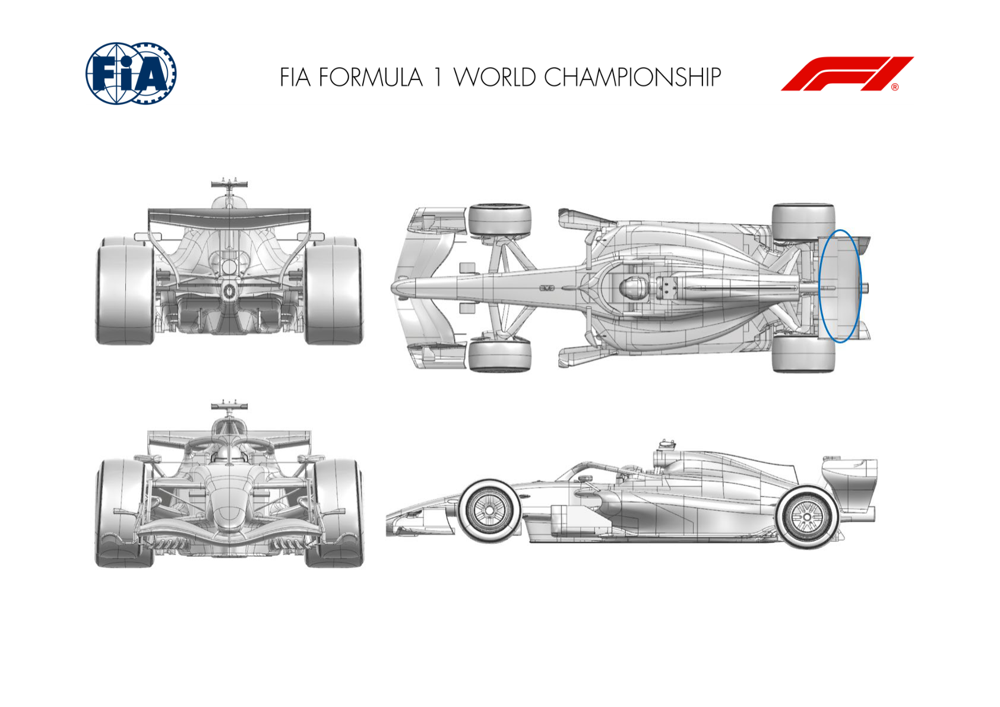
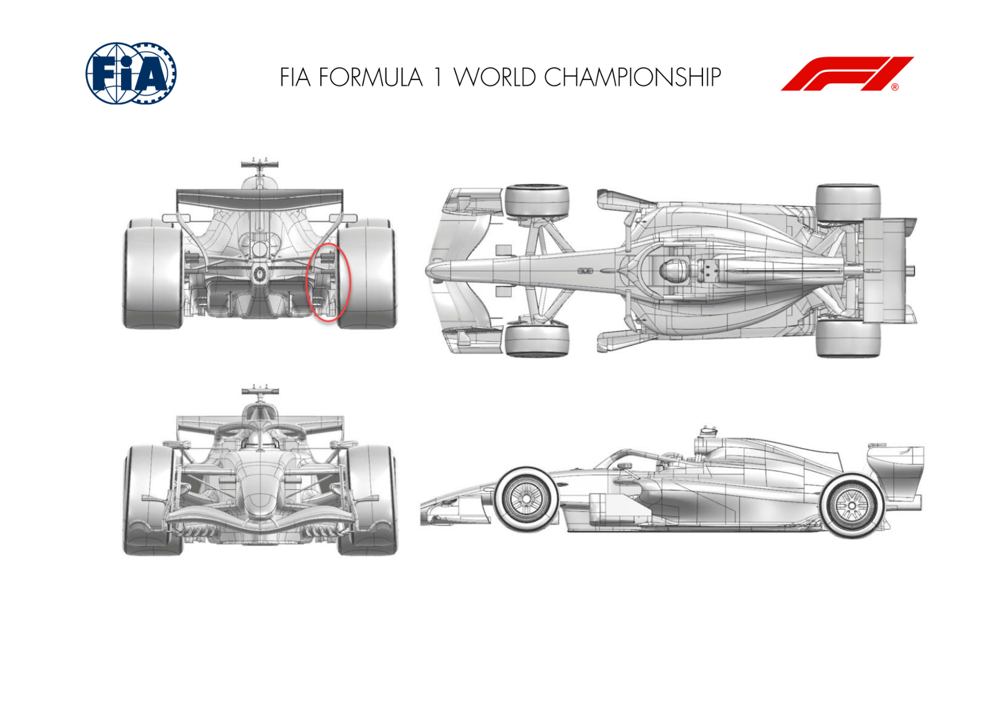

2026 LAS VEGAS GRAND PRIX

19 - 21 November 2026

From The FIA Formula 1 Media Delegate Document 9

To All Teams, All Officials Date 19 November 2026

Time 13:54

Title Car Presentation Submissions

Description Car Presentation Submissions

Enclosed 2026 Las Vegas Grand Prix - Car Presentation Submissions.pdf

Cameron Kelleher

The FIA Formula 1 Media Delegate

Car Presentation – Las Vegas Grand Prix

McLaren Mastercard F1 Team

| No. | Updated component | Primary reason for update | Geometric differences | Description |
| --- | --- | --- | --- | --- |
| 1 | Floor Furniture | Performance - Flow Conditioning | New Board and Floor Edge | A new floor board has been designed in conjunction with floor edge and diffuser, aiming at improved flow conditioning and aerodynamic load. |
| 2 | Floor Furniture | Performance - Flow Conditioning | Modified Rear Floor Furniture | A small modification to the rear floor furniture, manipulating rear corner and diffuser flow with the aim of increasing aerodynamic efficiency. |

Car Presentation – 2026 Las Vegas Grand Prix

Mercedes-AMG PETRONAS F1 Team

| No. | Updated component | Primary reason for update | Geometric differences | Description |
| --- | --- | --- | --- | --- |
| 1 | Rear Wing | Circuit specific - Drag Range | Various winglet devices removed from rear wing | Removing the rear wing winglets reduces assembly camber shedding local downforce and drag at a ratio appropriate for Vegas L/D. |
| 2 | Front Bodywork | Circuit specific - Drag Range | Mirror rear stay trim | The mirror stay trim reduces local camber and loading, shedding local downforce and drag at a ratio appropriate for Vegas L/D. |
| 3 | Rear Corner | Performance - Local Load | Rear corner winglets position and span | Rear corner winglets position and span optimised around local load requirements, shedding local downforce and drag at a ratio appropriate for Vegas L/D. |
| 4 | Engine Cover | Cooling Range | Narrower rear exit A narrower rear exit allows more cooling range, appropriate for the lower cooling requirements of Vegas. |  |

Car Presentation – USA-Las Vegas Grand Prix

Oracle Red Bull Racing

| No. | Updated component | Primary reason for update | Geometric differences | Description |
| --- | --- | --- | --- | --- |
| 1 | Front Wing Endplate | Performance - Local Load | Re-positioned Front Wing Endplate Dive-plane | In order to better protect the flow stability of the front wing endplate footplate as well as surfaces downstream, the dive-plane has been lowered and reduced in chord length. |

Car Presentation – Las Vegas Grand Prix

Scuderia Ferrari HP

| No. | Updated component | Primary reason for update | Geometric differences | Description |
| --- | --- | --- | --- | --- |
| 1 | Floor Board | Circuit specific - Drag Range | Front floor board elements optimisation, single vertical element The primary aim of these modifications has been to adapt to Las Vegas circuit peculiar characteristics and car aerodynamic efficiency requirements. It is targeting aerodynamic drag saving, coming along with downforce reduction as a natural consequence, but in a favourable ratio for this track. |  |

Car Presentation – Las Vegas Grand Prix

Williams

No Updates

Car Presentation – Las Vegas Grand Prix

Visa Cash App Racing Bulls

| No. | Updated component | Primary reason for update | Geometric differences | Description |
| --- | --- | --- | --- | --- |
| 1 | Floor Board | Circuit specific - Drag Range | Shorter chord board elements | A reduction in the amount of load generated by the Floor Board provides an improvement in overall efficiency and lap time around this circuit. |
| 2 | Rear Corner | Circuit specific - Drag Range | Modifications to drum winglets | An alternative winglet arrangement on the rear brake drums delivers an efficient load reduction, providing a net performance benefit at this track. |
| 3 | Front Wing | Circuit specific - Balance Range | Reduced chord & incidence flap | A low-balance front wing flap, featuring chord and incidence changes, is available for this circuit to reduce the load generated by the front wing and extend the available balance range. |

Car Presentation – Las Vegas Grand Prix

Aston Martin Aramco F1 Team

No updates submitted for this event.

Car Presentation – Las Vegas Grand Prix

TGR HAAS F1 Team

| No. | Updated component | Primary reason for update | Geometric differences | Description |
| --- | --- | --- | --- | --- |
| 1 | Rear Wing | Performance - Drag reduction | Revised rear wing arrangement associated with the Straight Mode mechanism | The revised arrangement is intended to evaluate an alternative rear wing Straight Mode deployment, with associated minor changes to accommodate the different configuration. |

Car Presentation – Las Vegas Grand Prix

Audi Revolut F1 Team

| No. | Updated component | Primary reason for update | Geometric differences | Description |
| --- | --- | --- | --- | --- |
| 1 | Rear Corner | Circuit Specific – Drag Range | Updated rear brake duct deflector | The revised rear brake duct deflector geometry was modified to match the specific aerodynamic efficiency requirements of the Las Vegas track. |

Car Presentation – Las Vegas Grand Prix

BWT Alpine F1 Team

No updates submitted for this event.

Car Presentation – Las Vegas Grand Prix

Cadillac

No updates for this event
