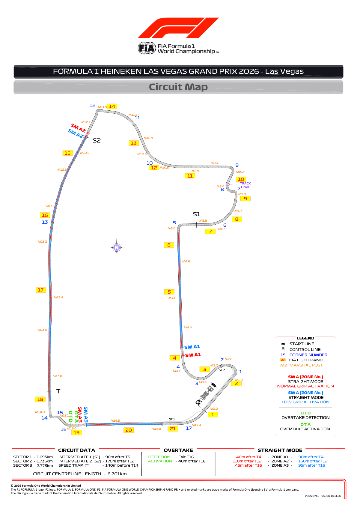
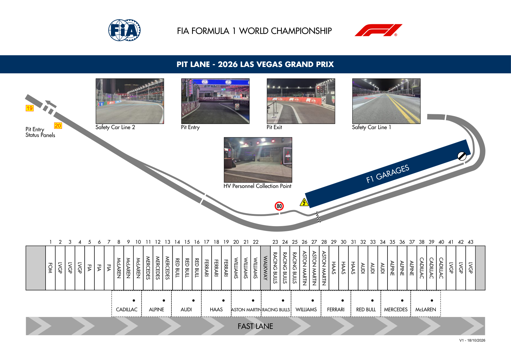
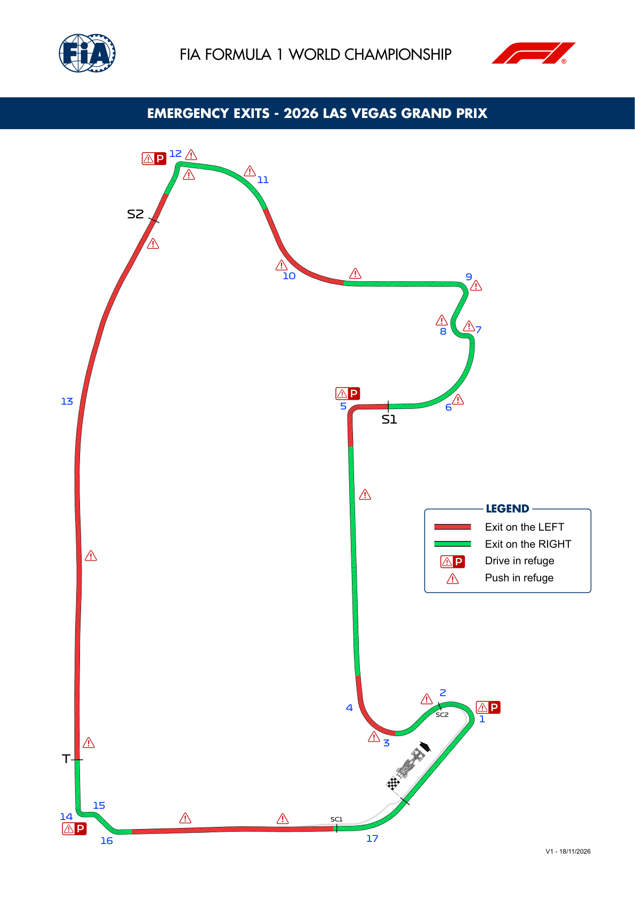
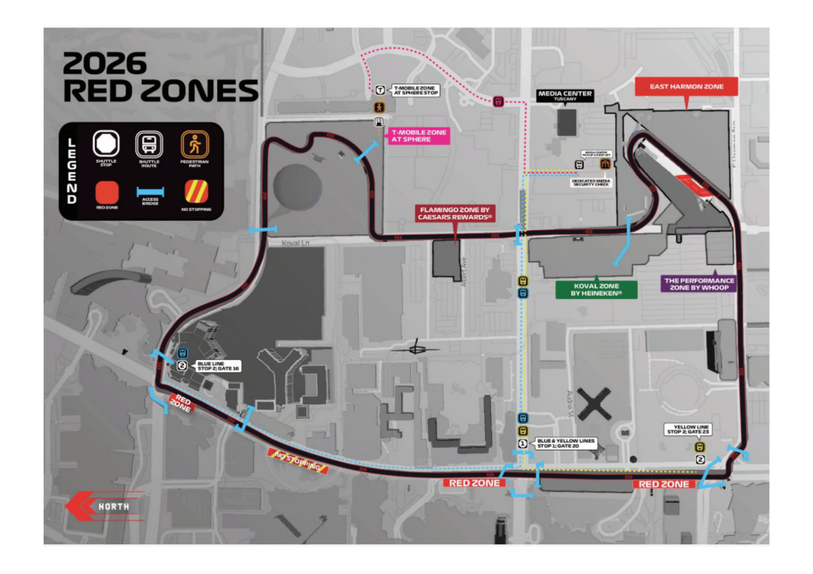

2026 LAS VEGAS GRAND PRIX

19 - 21 November 2026

From The FIA Formula 1 Race Director Document 6

To All Teams, All Officials Date 18 November 2026

Time 23:15

Title Circuit Map, Pit Lane Drawing, Emergency Exits Map and Red Zone

Description Circuit Map, Pit Lane Drawing, Emergency Exits Map and Red Zone

Enclosed 21LAS - Maps.pdf

Rui Marques

The FIA Formula 1 Race Director

