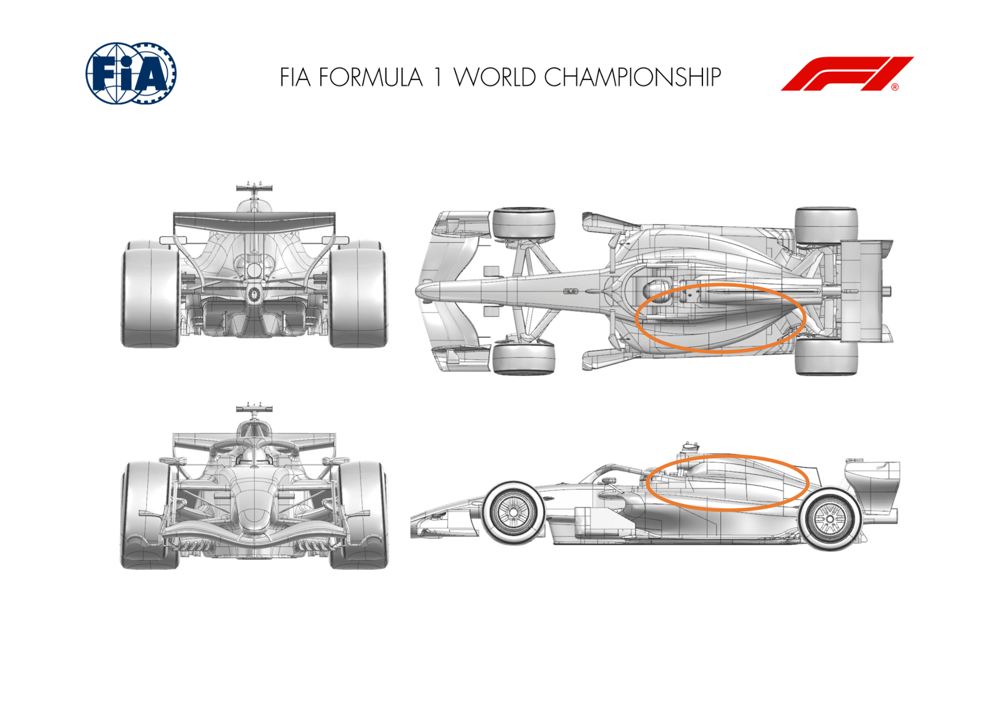
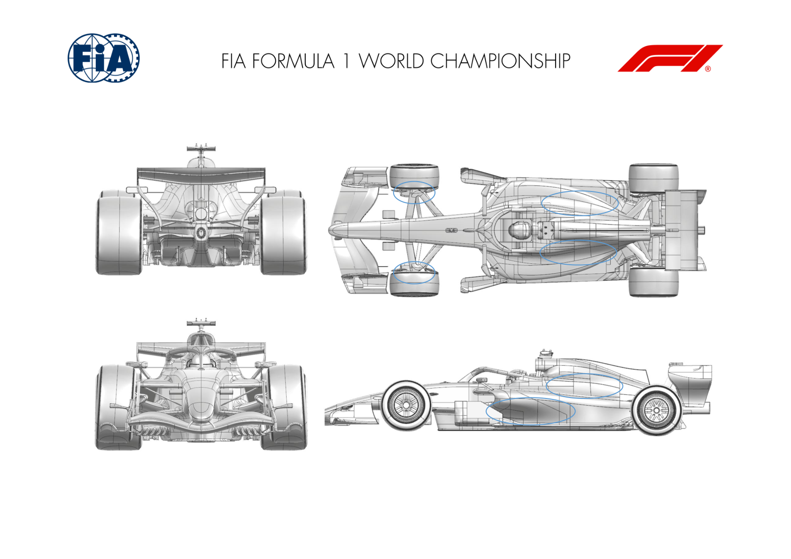
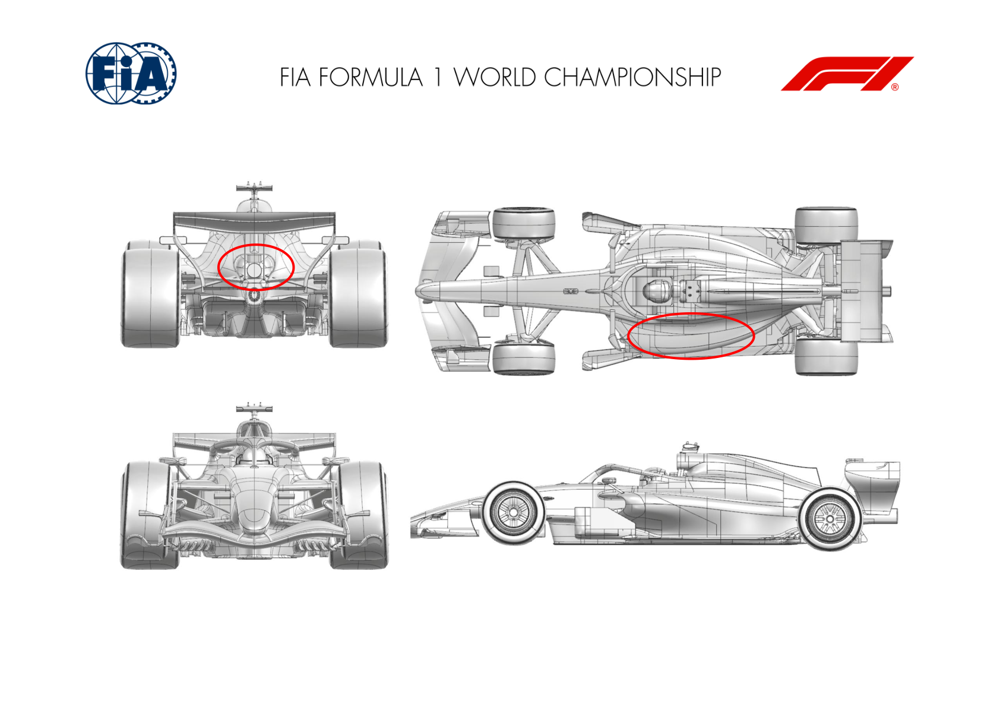
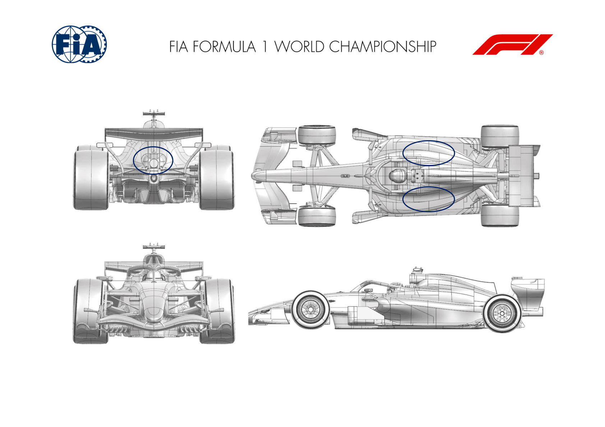
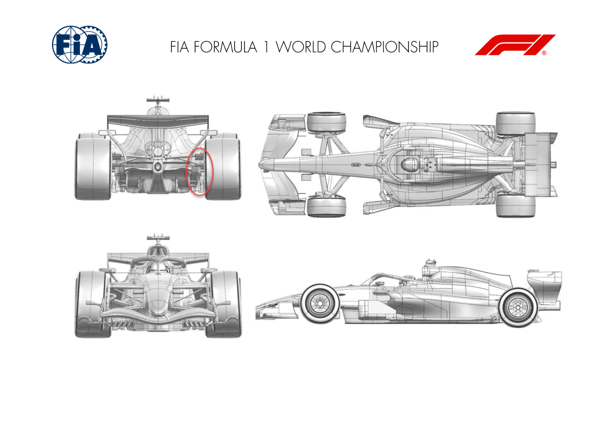
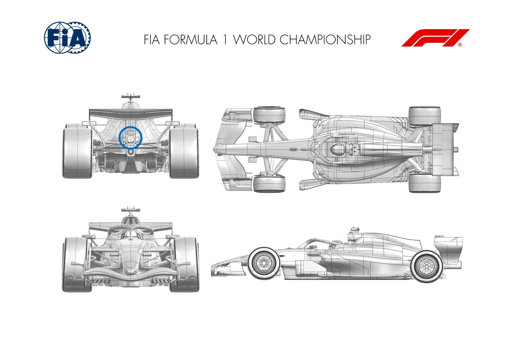

2026 MEXICO CITY GRAND PRIX

30 October - 01 November

From The FIA Formula 1 Media Delegate Document 12

To All Teams, All Officials Date 30 October 2026

Time 09:53

Title Car Presentation Submissions

Description Car Presentation Submissions

Enclosed 2026 Mexico City Grand Prix - Car Presentation Submissions.pdf

Roman De Lauw

The FIA Formula 1 Media Delegate

Car Presentation – Mexico City Grand Prix

McLaren Mastercard F1 Team

| No. | Updated component | Primary reason for update | Geometric differences | Description |
| --- | --- | --- | --- | --- |
| 1 | Cooling Louvres | Circuit specific - Cooling Range | Larger Cooling Louvres | To cope with the specific power unit cooling challenges in Mexico, the cooling louvres have been extended forwards and reshaped. |

Car Presentation – 2026 Mexico City Grand Prix

Mercedes-AMG PETRONAS F1 Team

No updates submitted for this event.

Car Presentation – Mexican Grand Prix

Oracle Red Bull Racing

| No. | Updated component | Primary reason for update | Geometric differences | Description |
| --- | --- | --- | --- | --- |
| 1 | Engine Cover | Reliability | Additional cooling exit louvres | To recover cooling mass flow through the radiators, the exit area has been increased by extending the area of the existing louvres and optional louvres further outboard. |
| 2 | Sidepod | Performance Local Load | Revised sidepod and floor to sidepod split line | Attached to existing sidepod geometry to improve the flow characteristics below the inlet to the radiator duct gaining local load whilst maintaining stability. |

Car Presentation – Mexico City Grand Prix

SCUDERIA FERRARI HP

| No. | Updated component | Primary reason for update | Geometric differences | Description |
| --- | --- | --- | --- | --- |
| 1 | Engine Cover | Circuit specific - Cooling Range | Enlarged rear bodywork exit, additional top sidepod louvre panels | Specific to the requirements of the Mexico City circuit, these new bodywork exit and additional louvre panels are extending the top end of the |
| 2 | Cooling Louvres |  |  | engine cooling capacity, at the expense of car efficiency |

Car Presentation – Mexico Grand Prix

Williams

No Updates

Car Presentation – Mexican Grand Prix

Visa Cash App Racing Bulls

| No. | Updated component | Primary reason for update | Geometric differences | Description |
| --- | --- | --- | --- | --- |
| 1 | Coke/Engine Cover | Circuit specific - Cooling Range | Larger rear upper exit | The main cooling exit at the rear of the bodywork has been enlarged, to increase the available engine cooling to suit the high demands of this circuit. |
| 2 | Cooling Louvres | Circuit specific - Cooling Range | Extended louvre panel options | To further extend the cooling range in extreme conditions, an additional forward louvre panel is available which allows for increased airflow through the radiators. |

Car Presentation – Mexico City Grand Prix

Aston Martin Aramco F1 Team

No updates submitted for this event.

Car Presentation – Mexico Grand Prix

TGR HAAS F1 TEAM

No update for this event

Car Presentation – Mexican Grand Prix

Audi Revolut F1 Team

| No. | Updated component | Primary reason for update | Geometric differences | Description |
| --- | --- | --- | --- | --- |
| 1 | Rear Corner | Performance – Local Load | Updated rear brake duct deflector | The revised rear brake duct deflector geometry represents a local rear corner aerodynamic load increase, improving the overall aerodynamic performance of the car. |

Car Presentation – Mexico Grand Prix

BWT Alpine F1 Team

| No. | Updated component | Primary reason for update | Geometric differences | Description |
| --- | --- | --- | --- | --- |
| 1 | Exhaust Tailpipe | Reliability | Reprofiled exhaust tailpipe vane | For Mexico, the tailpipe vane configuration has been trimmed to suit the track’s unique ambient and aerodynamic requirements. |

Car Presentation – Mexico Grand Prix

Cadillac

No updates for this event
