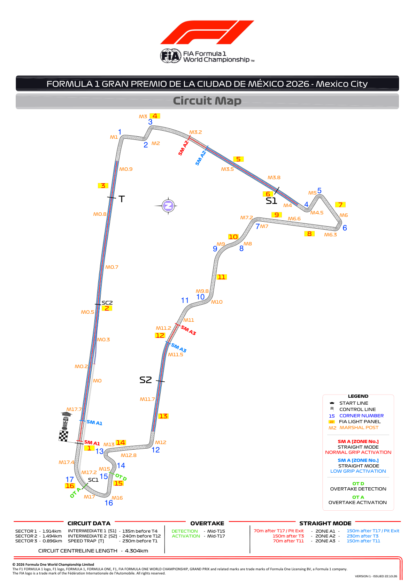
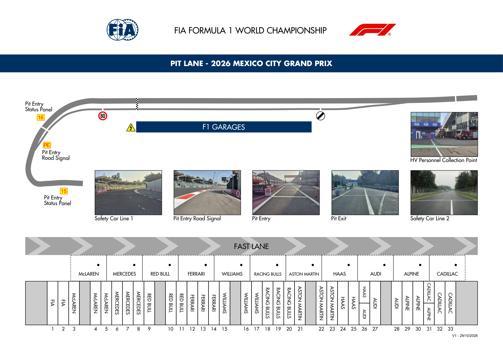
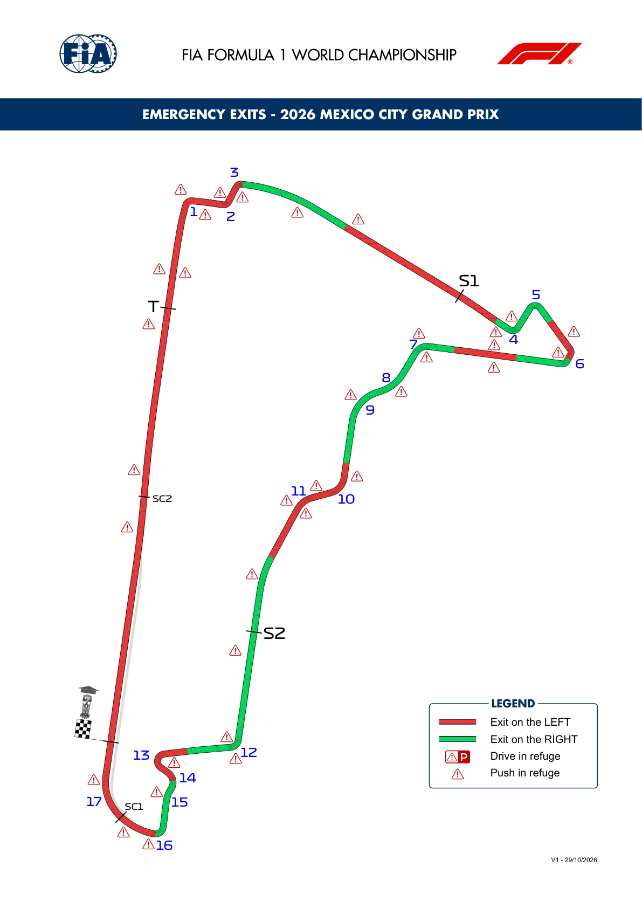

2026 MEXICO CITY GRAND PRIX

30 October - 01 November

From The FIA Formula 1 Race Director Document 7

To All Teams, All Officials Date 29 October 2026

Time 16:06

Title Circuit Map, Pit Lane Drawing and Emergency Exits Map

Description Circuit Map, Pit Lane Drawing and Emergency Exits Map

Enclosed 19MEX - Maps.pdf

Rui Marques

The FIA Formula 1 Race Director

