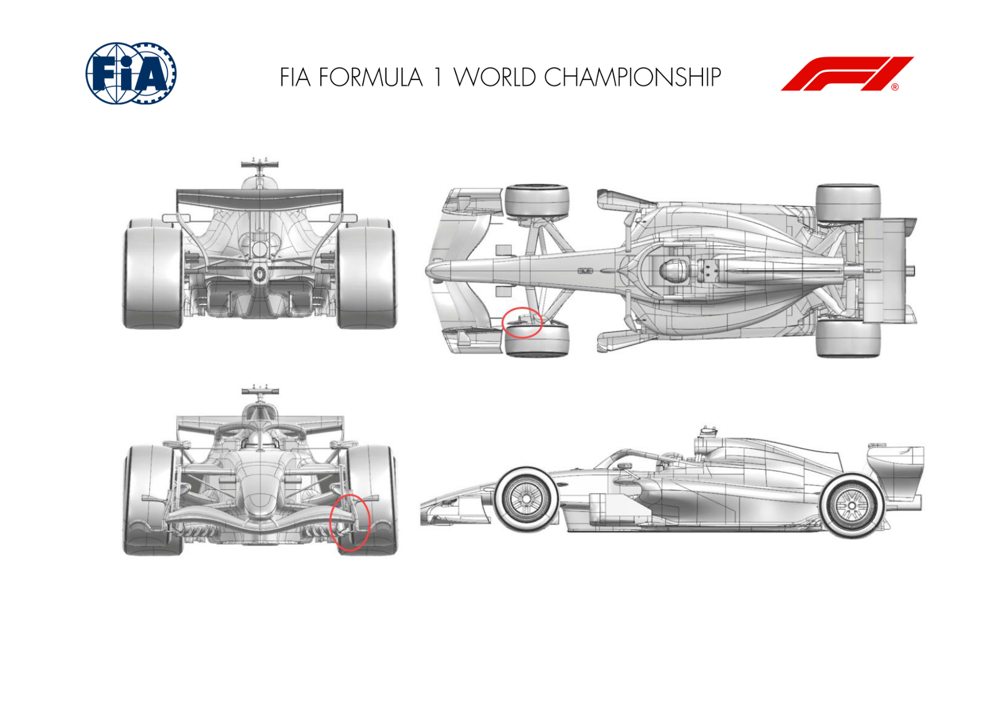

2026 QATAR GRAND PRIX

27 - 29 November 2026

From The FIA Formula 1 Media Delegate Document 12

To All Teams, All Officials Date 27 November 2026

Time 13:54

Title Car Presentation Submissions

Description Car Presentation Submissions

Enclosed 2026 Qatar Grand Prix - Car Presentation Submissions.pdf

Roman De Lauw

The FIA Formula 1 Media Delegate

Car Presentation – Qatar Grand Prix

McLaren Mastercard F1 Team

No updates submitted for this event.

Car Presentation – 2026 Qatar Grand Prix

Mercedes-AMG PETRONAS F1 Team

No updates submitted for this event.

Car Presentation – Qatar Grand Prix

Oracle Red Bull Racing.

No updates submitted for this event.

Car Presentation – Qatar Grand Prix

SCUDERIA FERRARI HP

No updates submitted for this event.

Car Presentation – Qatar Grand Prix

Williams

No Updates

Car Presentation – Qatar Grand Prix

Visa Cash App Racing Bulls

No updates submitted for this event.

Car Presentation – Qatar Grand Prix

Aston Martin Aramco F1 Team

No updates submitted for this event.

Car Presentation – Qatar Grand Prix

TGR HAAS F1 TEAM

No update for this event

Car Presentation – Qatar Grand Prix

Audi Revolut F1 Team

| No. | Updated component | Primary reason for update | Geometric differences | Description |
| --- | --- | --- | --- | --- |
| 1 | Front Corner | Performance – Flow Conditioning | Updated front brake duct deflector | The revised front brake duct lower deflector improves the flow field quality delivered to the rest of the car throughout the car envelope. |

Car Presentation – Qatar Grand Prix

BWT Alpine F1 Team

No updates submitted for this event.

Car Presentation – Qatar Grand Prix

Cadillac

No updates for this event
