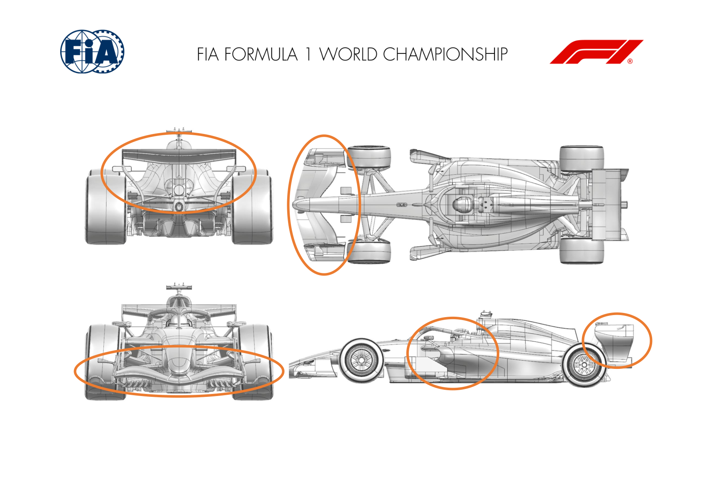

2026 SÃO PAULO GRAND PRIX

06 - 08 November 2026

From The FIA Formula 1 Media Delegate Document 12

To All Teams, All Officials Date 06 November 2026

Time 10:05

Title Car Presentation Submissions

Description Car Presentation Submissions

Enclosed 2026 Sao Paulo Grand Prix - Car Presentation Submissions.pdf

Roman De Lauw

The FIA Formula 1 Media Delegate

Car Presentation – Brazil Grand Prix

McLaren Mastercard F1 Team

| No. | Updated component | Primary reason for update | Geometric differences | Description |
| --- | --- | --- | --- | --- |
| 1 | Front Wing | Performance - Flow Conditioning | New Front Wing | A completely new front wing design, aimed at improved flow conditioning towards the floor and bodywork resulting in improved aerodynamic performance. |
| 2 | Rear Wing | Performance – Local Load | New Rear Wing Assembly | A new rear wing assembly has been designed for this event, aiming to increase aerodynamic load efficiently in all conditions. |
| 3 | Beam Wing | Performance - Flow Conditioning | New Beam Wing | In conjunction with the aforementioned rear wing, a new beam wing has been designed for improved interaction and flow conditioning. |
| 4 | Floor Furniture | Performance - Flow Conditioning | Updated Floor Furniture | A small modification to the floor furniture, resulting in better flow conditioning and resultant improvement of aerodynamic performance of the floor. |

Car Presentation – 2026 São Paulo Grand Prix

Mercedes-AMG PETRONAS F1 Team

No updates submitted for this event.

Car Presentation – Brazilian Grand Prix

Oracle Red Bull Racing

No updates submitted for this event.

Car Presentation – Brazilian Grand Prix

SCUDERIA FERRARI HP

No updates submitted for this event.

Car Presentation – Brazil Grand Prix

Williams

No Updates

Car Presentation – Brazilian Grand Prix

Visa Cash App Racing Bulls

No updates submitted for this event.

Car Presentation – Sao Paulo Grand Prix

Aston Martin Aramco F1 Team

No updates submitted for this event.

Car Presentation – Brazil Grand Prix

TGR HAAS F1 TEAM

No update for this event

Car Presentation – Brazilian Grand Prix

Audi Revolut F1 Team

No updates submitted for this event.

Car Presentation – Brazilian Grand Prix

BWT Alpine F1 Team

No updates submitted for this event.

Car Presentation – Sao Paulo Grand Prix

Cadillac

No updates for this event
