2026 SÃO PAULO GRAND PRIX

06 - 08 November 2026

From The FIA Formula 1 Race Director Document 6

To All Teams, All Officials Date 05 November 2026

Time 18:41

Title Race Director's Competition Notes

Description Race Director's Competition Notes

Enclosed 2026 Sao Paulo Grand Prix Competition Notes.pdf

Rui Marques

The FIA Formula 1 Race Director

2026 S ÃO P AULO G RAND P RIX

06 – 08 November 2026

From The FIA Formula 1 Race Director

To All Officials, All Teams Date 05 November 2026

COMPETITION NOTES

General Instructions

1. Laps during Qualifying Session and Reconnaissance Lap(s) For the safe and orderly conduct of the Competition, other than in exceptional circumstances accepted as such by the Stewards, any driver that exceeds the maximum time from the Second Safety Car Line to the First Safety Car Line on ANY lap during and after the Qualifying Session, including in- laps and out-laps or during reconnaissance laps when the pit exit is opened for the Race, may be deemed to be going unnecessarily slowly. Teams and Drivers will be informed of the maximum time after the Second Practice Session. For the avoidance of doubt, this does not supersede Articles B1.8.5 and B4.1.1 of the FIA F1 Regulations, which apply to the entire Circuit, furthermore this includes the pit lane as well. Incidents will normally be investigated after the Qualifying Session or the Race.

2. Lapping during the Race

The International Sporting Code (ISC) requires drivers who are caught by another car to allow the faster driver past at the first available opportunity. The F1 marshalling system will be set to give a pre-warning when the faster car is within 3.0s of the car about to be lapped, this should be used by the team of the slower car to warn their driver he is soon going to be lapped and that allowing the faster car through should be considered a priority. When the faster car is within 1.2s of the car about to be lapped blue light panels will be shown to the slower car (in addition to blue light panels, blue cockpit lights and a message on the timing monitors) and the driver must allow the following driver to overtake at the first available opportunity.

1

Competition Specific Instructions

3. Marshalling System 3.1 A car entering the Pit Lane will be subject to the marshalling state (i.e. yellow flag or double yellow flag) of the associated sector until it passes the blue line marked on the image below.

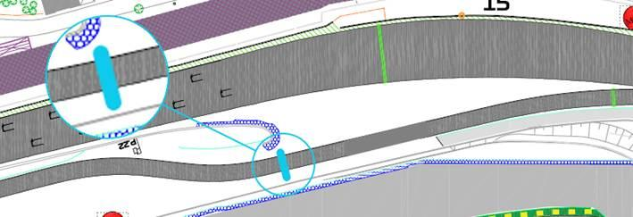

3.2 A car leaving the Pit Lane will be subject to the marshalling system state i.e. yellow flag or double yellow flag of the sector into which it is emerging after it passes the blue line marked on the image below.

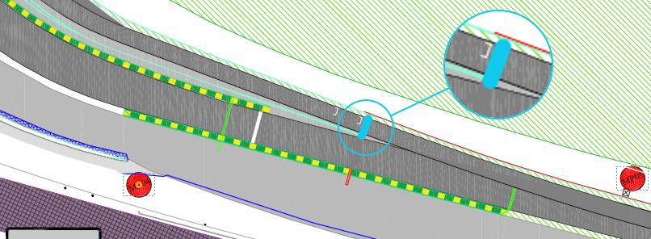

4. Support Races team barrier placement and movements No support categories in Formula 1 pit lane.

5. Practice starts 5.1 During the Free Practice sessions and the reconnaissance laps prior to the Race, practice starts may be carried out on the left-hand side of the pit exit road, using one of the painted grid boxes shown in the image below. Cars queuing to perform a practice start must be on the left-hand side, to allow sufficient space for cars not wishing to do a practice start to pass. There will be a marshal on the left behind the guardrail in the pit exit who will wave white flags when a car is stopped for the purpose of carrying out a practice start.

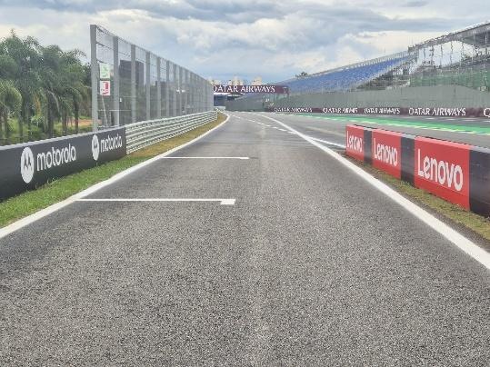

5.2 Practice starts after the Free Practice sessions will be performed according to Article B4.2.2 of the FIA F1 Regulations. 5.3 For the safe and orderly conduct of the competition, pursuant to article B4.2.2, any driver on track when the end of session signal is shown for the second Free Practice session, may complete two further laps, for the sole purpose of stopping on the grid to perform practice starts on each of these laps. 5.4 If the Free Practice sessions are resumed with less than 2 minutes remaining, for the purpose of facilitating practice starts on the grid as provided for in Article B4.2.2 of the FIA F1 Regulations, any car wishing to leave the Pit Lane must proceed down the Pit Lane without undue delay and exit the Pit Lane without leaving a significant gap to the car ahead.

2

5.5 For the avoidance of doubt, practice starts may not be carried out during the Qualifying session. 5.6 Under no circumstances can drivers perform a practice start if another F1 Car remains stationary in front of them.

6. Article B1.6.3d of the FIA F1 Regulations (…) Any car(s) driven to the end of the Pit Lane prior to the start or re-start of a LTCS must form up in a line in the Fast Lane and leave in the order they got there (…) It is noted that a car will be considered to be “in the fast lane” when a tyre has crossed the solid white line separating the fast lane from the inner lane, in this context crossing means that all of a tyre should be beyond the far side, with respect to the garages, of the line separating the fast lane from the inner lane.

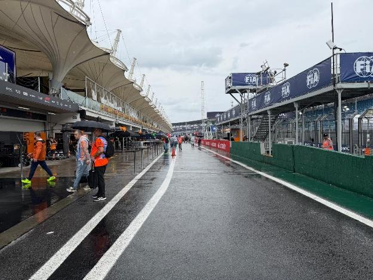

For the avoidance of doubt, Appendix L, Chapter IV, Article 5 b) to the ISC states that: Once a car has left its garage or pit stop position it should blend into the fast lane as soon as it is safe to do so, and without unnecessarily impeding cars which are already in the fast lane. Thus, after the start or re-start of the Free Practice session or the Qualifying Session, if there is a suitable gap in a queue of cars in the fast lane, such that a driver can blend into the fast lane safely and without unnecessarily impeding cars already in the fast lane, they are free to do so. Furthermore, it is noted that during the Free Practice sessions and Qualifying, a car driving in the inner lane, parallel to the fast lane, will not be considered to have blended into the fast lane at the earliest opportunity. Additionally, Appendix L, Chapter IV, Article 5 d) to the ISC states that: Cars in either the fast lane or working lane may not overtake other cars in the fast lane except in exceptional circumstances. In this context a “stopped car” is one which has an obvious mechanical problem.

7. Lines at the Pit Entry and Pit Exit 7.1 In accordance with Appendix L, Chapter IV, Articles 4 and 6 to the ISC drivers must follow the procedures at pit entry and pit exit. 7.2 Pertaining to Chapter 4, Article 4 of Appendix L to the ISC any driver passing to the left-hand side of the intersection of the dashed line with the continuous line (as indicated in the image below) will be considered as entering the pit lane.

3

7.3 For safety reasons, drivers must keep to the left of the solid white line at the pit entry when they are entering the pits.

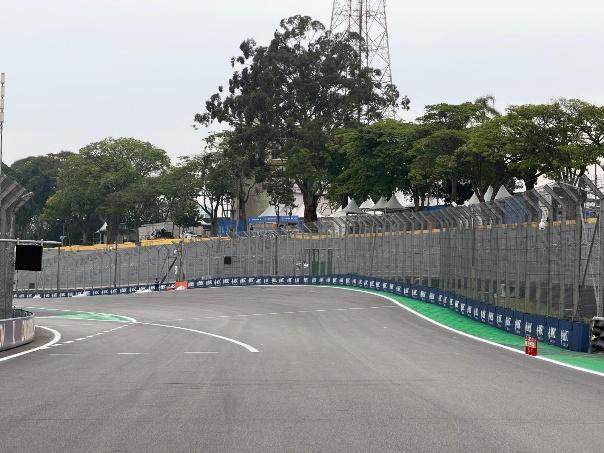

7.4 Additionally, drivers must keep to the left of the 1st bollard and to the right of the 2nd bollard at the pit entry road.

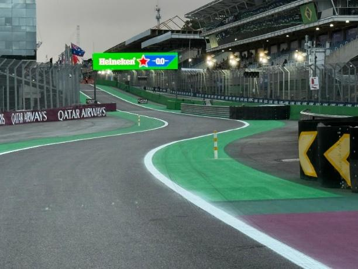

7.5 During the reconnaissance laps prior to the Race drivers are allowed to cross the white line separating the pit exit road from the circuit. 7.6 For the safe and orderly conduct of the event, during any live session, team personnel are not allowed in the pit lane beyond the reference point in the picture below (in front of the walkway at pit entry).

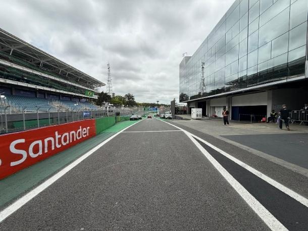

7.7 A marshal placed at the end of the pit exit road (after the practice start area) will display a blue flag for the cars leaving pit lane when another car is approaching on the track.

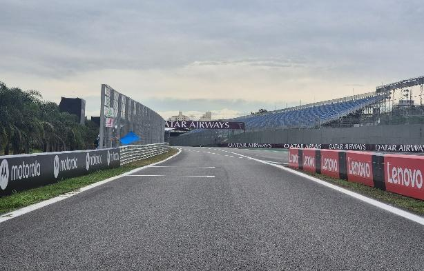

4

7.8 If there is a white light panel displayed on left-hand side in the pit entry road it will be a warning of an incident at the pit entry road. This flag is not intended for drivers staying on track. This panel will also represent the pit entry status (pit lane closed and all cars through the pit lane).

7.9 If there is a white flag displayed on left-hand side of the pit exit road it will be a warning of an incident or a F1 car stopped for a practice start at the pit exit road. This flag is not intended for drivers staying on track.

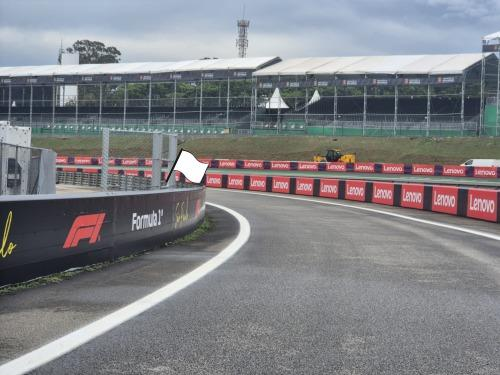

8. Stopping the Qualifying Session Pursuant to Article B4.3.1b of the FIA F1 Regulations, should any period of the Qualifying Session be interrupted with less than 70 seconds remaining, the relevant period of the relevant Session will not be resumed.

9. ERS Hazard Status If the ERS is in a Hazard Status, the relevant team will be required to send mechanics to FIA garage 0. This will be done after the session. They will then be picked up by car and taken to their F1 car.

10. Leaving the garage before and during all Sessions 10.1 Before the start of the Free Practice sessions and Qualifying, or prior to the pit exit opening for the reconnaissance laps, no cars may enter the pit lane to proceed to pit exit until 5 minutes before the scheduled start time or announced start time in the case of a delayed session. 10.2 If the Free Practice session, the Qualifying, or any period thereof is delayed or stopped, cars may only enter the Fast Lane after the re-start time is confirmed via the official messaging system.

11. Removing cars from the grid Cars may be removed from the grid through the gate adjacent to the grid positions 17 and garage 7.

12. Race Suspension or Starting Procedure Suspension 12.1 In case of Race suspension or Starting Procedure suspension, (except in case of Article B5.14.3 of the FIA F1 Regulations – stopping on the grid), cars will be stopped in the fast lane. The first car must stop in the vicinity of the last team garage. 5

Safety Car Resumption Point: Safety Car will leave the pit lane before the resumption and wait for the F1 cars before Turn 8 (as per the image below).

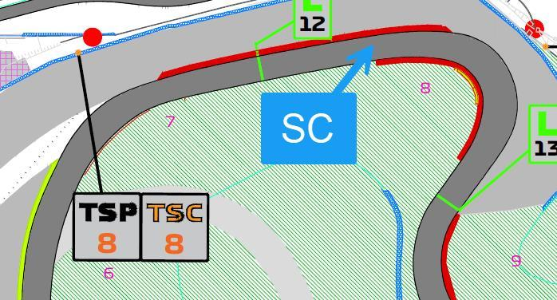

13. Grid Panel Placement On the right-hand side of the grid.

14. Light panels In case of an incident, the yellow and double yellow light panel will be mirrored on the panels below: - Panel 15 will be mirrored on panel 14. - Panel 16 will be mirrored on panels 15 and 14.

15. Grid Procedure Article B5.2.4 of the FIA F1 Regulations states that “Any F1 Car which does not complete a reconnaissance lap and reach the grid under its own power will not be permitted to start the TTCS from the grid.”. In the context of this Article the grid shall be considered to be the section of track starting from the front of marked grid box #1 until the start of the pit wall as per the image below.

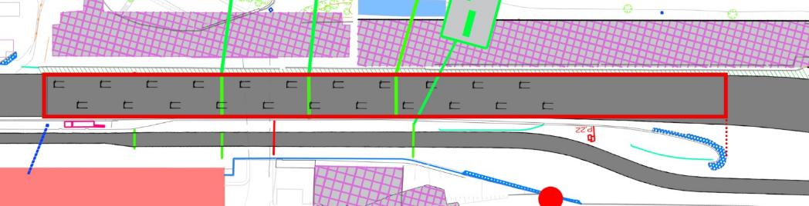

16. Safety Car Procedures For the safe and orderly conduct of the Competition, and specifically to ensure that all Competitors receive consistent information regarding any Safety Car deployment, pursuant to Articles B5.13.1 [Deployment of Safety Car] and B5.13.6 [Withdrawal of Safety Car] of the FIA F1 Regulations, “waved yellow flags and “SC” boards” will NOT be used at this Competition. For the avoidance of doubt, when the order is given to deploy the Safety Car the message “SAFETY CAR DEPLOYED” will be sent to all Competitors and all Trackside Light Panels will display “SC”. Furthermore, to ensure that all Competitors receive consistent information regarding the withdrawal of the Safety Car, when the instruction to extinguish the orange lights on the Safety Car is given, the message “SAFETY CAR LIGHTS OFF” will be sent to all Competitors. For the avoidance of doubt, as the leader approaches the Control Line a green light panel will be displayed at the Control Line and all other Trackside Lights Panel will clear i.e. will cease to display “SC”. Pursuant to Article B5.13.8, if the Safety Car is still deployed at the beginning of the last lap, or is deployed during the last lap, unless the Race Director deems the continued presence of the Safety Car after the end-of-session signal is required, it will enter the Pit Lane at the end of the lap and the F1 Cars must proceed to take the end-of-session signal without overtaking before the Control Line. In such circumstance, the Trackside Light Panels will continue to display “SC” but, as the Safety Car is approaching the Pit Entry Road, the orange lights on the Safety Car will be extinguished and the message “SAFETY CAR LIGHTS OFF” will be sent to all Competitors. This will be the signal to all Competitors and drivers that the Safety Car will be entering the Pit Lane at the end of that lap.

6

17. Free Practice Collective Test Items The FIA plans the following collective test items during free practice sessions: 17.1 Free Practice 1 When the last car has performed his practice start from the grid, VSC will be deployed until all cars have return to the pit lane.

18. Changes to the circuit - Circuit partially resurfaced from exit of turn 3 to exit of turn 4. - Circuit partially resurfaced from exit of turn 4 to exit of turn 5. - Circuit partially resurfaced from exit of turn 8 to exit of turn 9. - Grasscrete on RHS removed before apex of turn 1 and replaced with concrete. - Grasscrete on RHS removed before apex of turn 4 and replaced with concrete. - Grasscrete on RHS removed before apex of turn 12 and replaced with concrete. - New blue lines for track limits detection added at most turns. - Yellow kerb at turn 2 apex reduced in height. - Yellow kerb at turn 8 apex reduced in height. - Yellow kerb at turn 10 apex reduced in height. - New debris fencing installed LHS between turn 5 and turn 6. - Digital light panels adjusted so that they are at a uniform height off the ground. - Asphalt patch repair at the exit of Turn 13 on the right-hand side.

Rui Marques

The FIA Formula 1 Race Director

7
