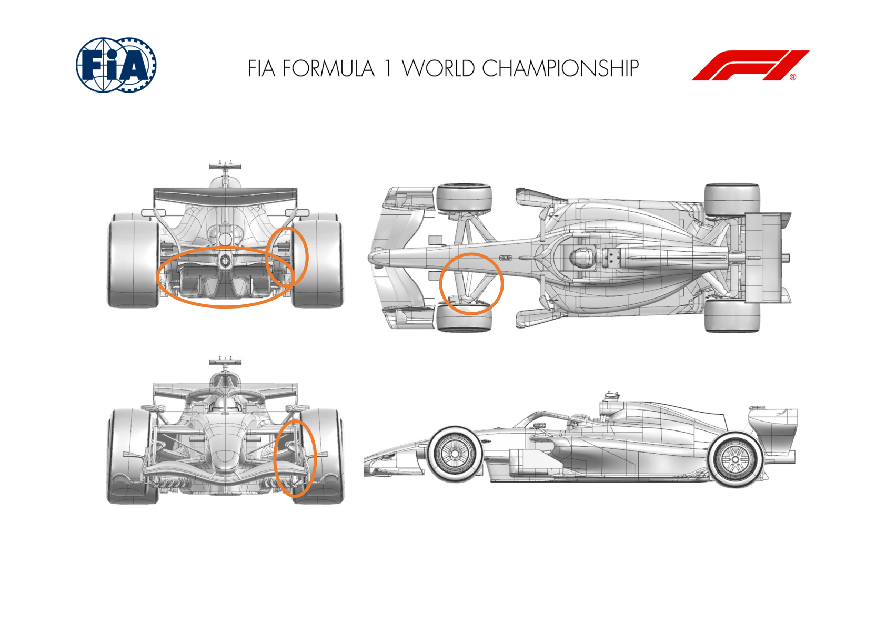
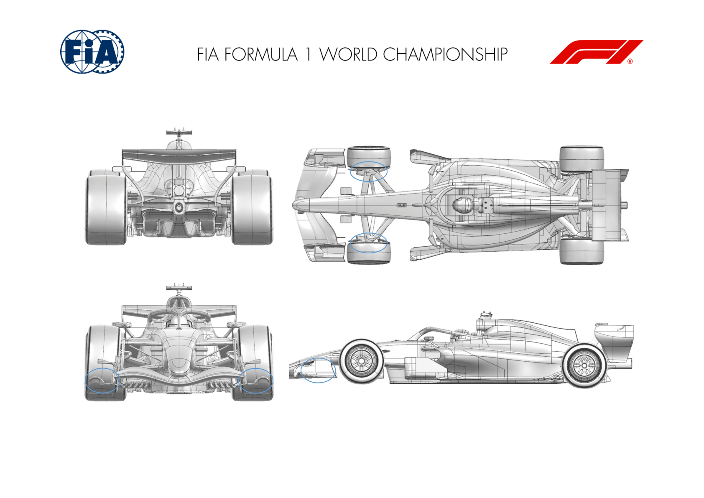
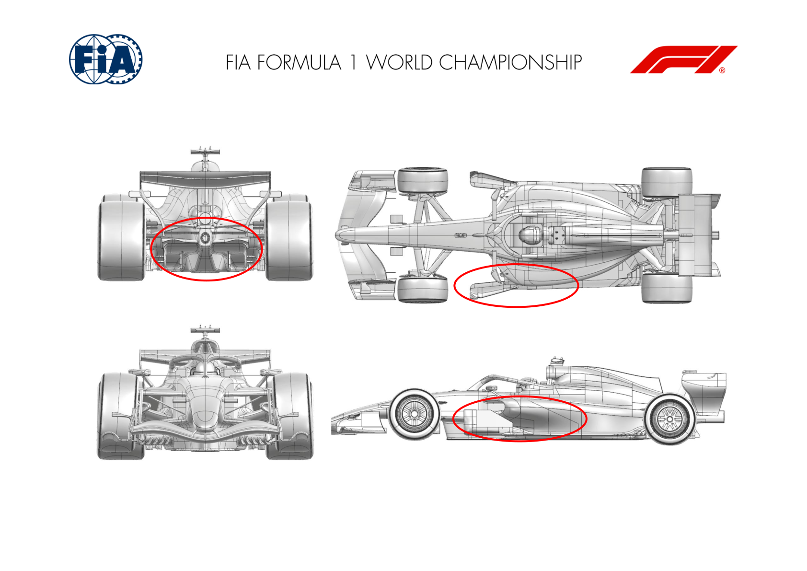
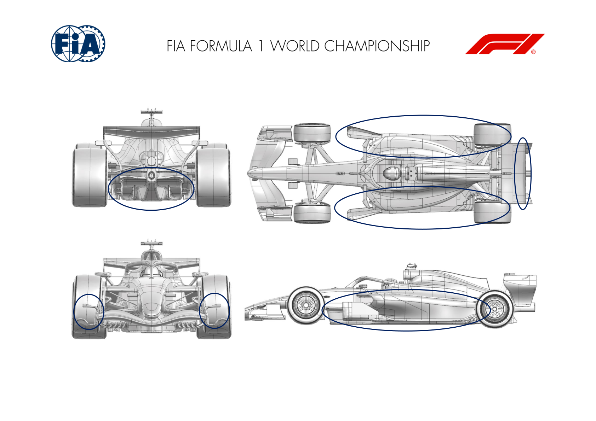
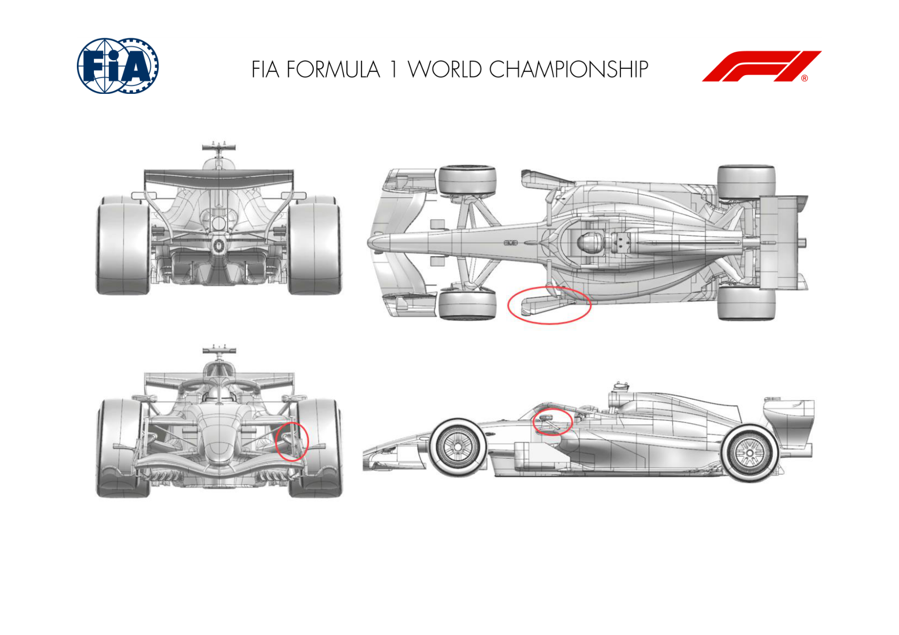
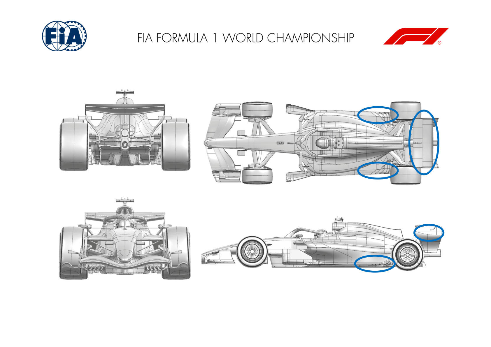
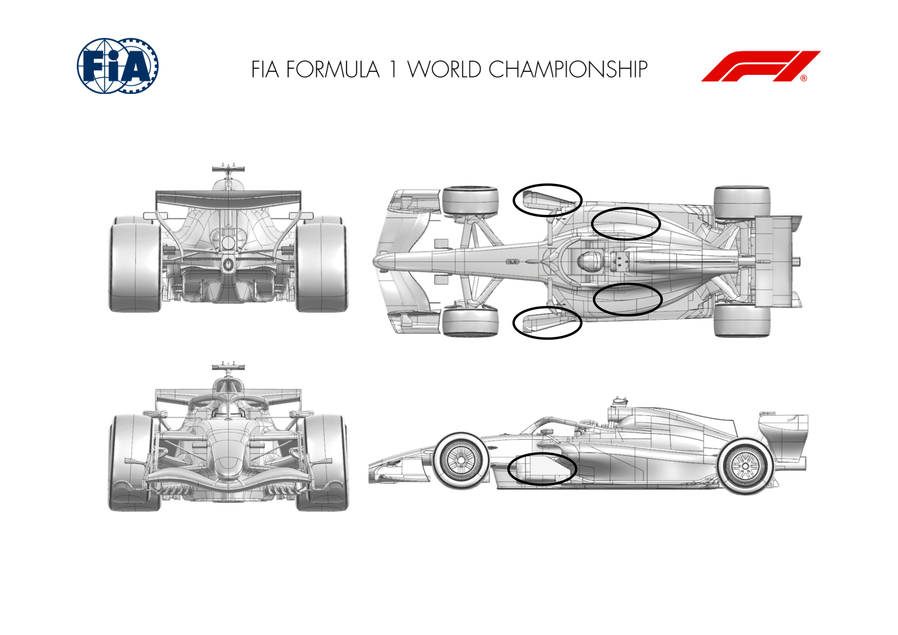

2026 UNITED STATES GRAND PRIX

23 - 25 October 2026

From The FIA Formula 1 Media Delegate Document 11

To All Teams, All Officials Date 23 October 2026

Time 09:55

Title Car Presentation Submissions

Description Car Presentation Submissions

Enclosed 2026 United States Grand Prix - Car Presentation Submissions.pdf

Cameron Kelleher

The FIA Formula 1 Media Delegate

Car Presentation – United States Grand Prix

McLaren Mastercard F1 Team

| No. | Updated component | Primary reason for update | Geometric differences | Description |
| --- | --- | --- | --- | --- |
| 1 | Front Corner | Performance - Flow Conditioning | Revised Front Corner and Furniture | The front corner scoop and furniture have been revised in conjunction with the front suspension fairings aiming at improved flow conditioning. |
| 2 | Rear Corner | Performance - Flow Conditioning | Updated Rear Corner Furniture | The rear corner furniture has been revised to achieve an improvement in flow conditioning as well as increased local load. |
| 3 | Diffuser | Performance - Flow Conditioning | New diffuser geometry | The diffuser geometry has been modified aiming at an improvement of flow conditioning and local load across the speed range. |

Car Presentation – 2026 United States Grand Prix

Mercedes-AMG PETRONAS F1 Team

No updates submitted for this event.

Car Presentation – USA-Austin Grand Prix

Oracle Red Bull Racing

| No. | Updated component | Primary reason for update | Geometric differences | Description |
| --- | --- | --- | --- | --- |
| 1 | Front Wing | Performance - Local Load | Additional vane on the endplate foot plate | Taking the recently introduced front wing geometry, an option to operate with the tyre temperature turning vane has been added for evaluation, offering a tyre surface temperature measurement as well as more local load with similar flow stability. |
| 2 | Front Corner | Reliability | Elastomeric gaitor profile revision | The periphery of the gaitor has been revised to reduce the likelihood of tearing the elastomeric material during running by reducing the strain in the regions of highest deflection when steering lock is applied. |

Car Presentation – United States Grand Prix

SCUDERIA FERRARI HP

| No. | Updated component | Primary reason for update | Geometric differences | Description |
| --- | --- | --- | --- | --- |
| 1 | Floor Body | Performance – Local Load and Flow Conditioning | Updated board brace layout, redesigned front floor leading edge reshaping of both inboard vertical and top horizontal board elements Key development features have focused on increasing floor downforce (on both front and rear parts) whilst also increasing energy levels and flow stability sent towards the back of the car |  |
| 2 | Floor Board |  |  |  |
| 3 | Sidepod Inlet / Coke |  | Sidepod inlet additional lower volume, reshaped undercut and coke line volumes |  |
| 4 | Diffuser |  | Revised diffuser volume, expansion profile, fence loading and trailing edge outboard furniture | Benefitting from improved onset flow quality, the diffuser expansion and overall geometry has been further optimized, and returns increased aerodynamic load in an efficient way |

Car Presentation – USA Grand Prix

Williams

No Updates

Car Presentation – United States Grand Prix

Visa Cash App Racing Bulls

| No. | Updated component | Primary reason for update | Geometric differences | Description |
| --- | --- | --- | --- | --- |
| 1 | Front Wing | Performance - Flow Conditioning | New front wing endplate | The front wing endplate plays an important role in managing the flow around the front tyres. These updates further improve the management of the flow field downstream. |
| 2 | Rear Wing | Performance - Local Load | New flap elements | The camber and chord of the rear wing flap elements has been modified to clean up the local flow and allow the wing to generate more load. |
| 3 | Floor Body | Performance - Local Load | Multiple changes including leading edge devices, board and floor edge | A combination of developments across a number of flow management around the floor. This translates into an efficient downforce increase. |
| 4 | Coke/Engine Cover | Performance - Flow Conditioning | Reprofiled shoulder and undercut | Working in combination with the updates made to the floor, the changes to the engine cover help manage the flow as it passes around the side of the car and towards the rear. |

Car Presentation – United States Grand Prix

Aston Martin Aramco F1 Team

No updates submitted for this event.

Car Presentation – Austin Grand Prix

TGR HAAS F1 TEAM

No update for this event

Car Presentation – United States Grand Prix

Audi Revolut F1 Team

| No. | Updated component | Primary reason for update | Geometric differences | Description |
| --- | --- | --- | --- | --- |
| 1 | Front Corner | Performance - Flow conditioning | New front brake duct | The revised front brake duct provides updated cooling characteristics together with associated aerodynamic performance, complementing the latest development steps introduced. |
| 2 | Front Floor | Performance - Flow conditioning | New Floor Board | The updated floorboard geometry is intended to improve local flow conditioning and support the overall aerodynamic performance of the floor assembly. |
| 3 | Mirror stay | Performance - Flow conditioning | New Mirror Stay | The updated mirror stay geometry complements the revised front corner configuration and supports the overall aerodynamic performance of the car package introduced lately. |

Car Presentation – United States Grand Prix

BWT Alpine F1 Team

| No. | Updated component | Primary reason for update | Geometric differences | Description |
| --- | --- | --- | --- | --- |
| 1 | Floor Corner | Performance - Local Load | Redesigned rear floor corner | The rear floor corner has been redesigned to improve the local flowfield interaction with the rear corner while also increasing local load. |
| 2 | Rear Wing | Performance - Local Load | Reprofiled rear wing flap | The second and third element flap of the rear wing have been redesigned to improve rear wing flow quality and overall load delivery. |

Car Presentation – United States Grand Prix

Cadillac

| No. | Updated component | Primary reason for update | Geometric differences | Description |
| --- | --- | --- | --- | --- |
| 1 | Floor Fences | Performance – Flow Conditioning | Updated Forward Floor Fence Geometry | Revised geometry improves flow conditioning to the rear of the car and reduces sensitivity to changes in car attitude, whilst retaining overall aerodynamic load |
| 2 | Cooling Louvres | Performance – Cooling Range | Updated Sidepod Top Deck Cooling Louvres | The sidepod top deck louvres have been updated to increase the power unit cooling capacity, whilst minimising the effect on aerodynamic performance |

